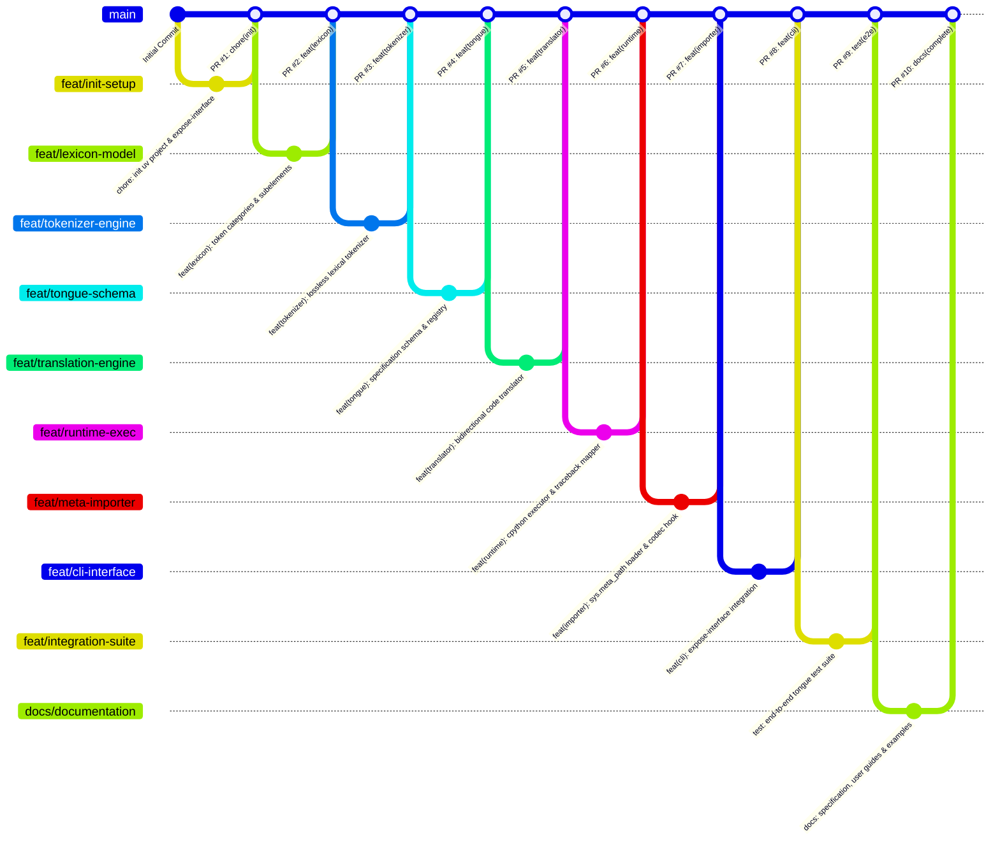

# Parsethon Implementation Plan

**Parsethon** is an extensible Python lexical parser, tokenization engine, and language translation system. It allows developers to define a **"Tongue"**—a customized lexicon of keywords, operators, delimiters, and syntax tokens—write programs using that Tongue, and translate them losslessly back to standard Python syntax for direct execution by the CPython interpreter.

---

## 1. Architectural Overview

```
                      +-----------------------------------+
                      |       Tongue Source Code          |
                      |  (e.g., script.es.py / emoji.py)  |
                      +-----------------+-----------------+
                                        |
                                        v
                      +-----------------------------------+
                      |      Parsethon Tokenizer          |
                      |  - Subelement Lexicon Analyzer    |
                      |  - Trivia & Span Preservation     |
                      +-----------------+-----------------+
                                        |
                                        v
                      +-----------------------------------+
                      |       Tongue Translation          |
                      |  - Token Replacement Engine       |
                      |  - Collision & Context Detection  |
                      +-----------------+-----------------+
                                        |
                                        v
                      +-----------------------------------+
                      |     CPython Source Code           |
                      |     (Standard Python AST/Code)    |
                      +-----------------+-----------------+
                                        |
                                        v
                      +-----------------------------------+
                      |   Execution Engine / Importer     |
                      |   - Traceback & Error Mapper      |
                      |   - sys.meta_path Loader          |
                      +-----------------------------------+
```

### Core Design Principles
1. **Lossless Token Representation:** Every token tracks its exact category, subelement, text, trivia (leading/trailing whitespace, comments), and source coordinates (line/col).
2. **First-Class "Tongue" Abstraction:** A declarative, validated specification for lexical token substitution (keywords, boolean/null literals, logical operators, symbolic delimiters, and built-ins).
3. **Execution Fidelity:** Translated Python code runs under standard CPython with 100% semantic equivalence and accurate source mapping during exceptions.
4. **Minimal Dependencies:** Zero third-party runtime dependencies beyond the in-house CLI dependency `expose-interface`.

---

## 2. Conventional Commits & Pull Request Roadmap

The implementation is structured into 10 incremental, reviewable, and test-driven PRs. Each PR will be executed on a dedicated feature branch and squash-merged to `main`.



---

### PR 1: `chore(setup): project initialization, environment setup, and test harness`
- **Branch:** `feat/project-setup`
- **Scope:**
  - Initialize `uv` project structure in `Projects/parsethon`.
  - Configure `pyproject.toml` with `expose-interface` dependency and build system.
  - Set up Python package root under `src/parsethon/`.
  - Set up `tests/` harness with `unittest` (preserving zero test framework dependency requirements).
  - Initialize git repository with `.gitignore` and baseline CI/verification script.
- **Verification:**
  - `python3 -m unittest discover tests` runs clean.
  - `expose-interface` installs and imports without error.

---

### PR 2: `feat(lexicon): token categories, subelements, and lexical grammar definitions`
- **Branch:** `feat/lexicon-model`
- **Scope:**
  - Define `TokenCategory` (KEYWORD, LITERAL, OPERATOR, DELIMITER, IDENTIFIER, WHITESPACE, INDENTATION, COMMENT, STRING_PART).
  - Define `TokenSubelement` hierarchical taxonomy:
    - Keywords: Control Flow (`if`, `elif`, `else`, `while`, `for`, `break`, `continue`, `return`, `yield`, `pass`, `match`, `case`), Definition (`def`, `class`, `lambda`, `async`, `await`), Scope (`global`, `nonlocal`, `del`), Exception (`try`, `except`, `finally`, `raise`, `assert`), Context (`with`, `as`), Import (`import`, `from`, `as`).
    - Operators: Arithmetic (`+`, `-`, `*`, `/`, `//`, `%`, `**`, `@`), Bitwise (`&`, `|`, `^`, `~`, `<<`, `>>`), Comparison (`==`, `!=`, `<`, `<=`, `>`, `>=`), Assignment (`=`, `+=`, `-=`, `*=`, etc.), Logical (`and`, `or`, `not`, `is`, `in`).
    - Delimiters: Enclosure (`(`, `)`, `[`, `]`, `{`, `}`), Separators (`,`, `:`, `.`, `;`, `->`).
    - Literals: Boolean (`True`, `False`), Null (`None`), Numbers (Decimal, Hex, Octal, Binary, Float, Complex), Strings (single, double, triple-quoted, raw, bytes, f-string prefixes).
  - Define `LexicalToken` dataclass with position spans (`start_line`, `start_col`, `end_line`, `end_col`), leading trivia, trailing trivia, category, subelement, raw value, and canonical representation.
- **Verification:**
  - Unit tests in `tests/test_lexicon.py` covering all token categories, subelement mappings, and representation invariants.

---

### PR 3: `feat(tokenizer): lossless lexical tokenizer with trivia and span tracking`
- **Branch:** `feat/tokenizer-engine`
- **Scope:**
  - Implement `ParsethonTokenizer` capable of parsing arbitrary Python source text into `List[LexicalToken]`.
  - Precise handling of:
    - Indentation stack (`INDENT`, `DEDENT`, newline normalization).
    - String literals including triple-quoted multi-line strings and f-string tokens.
    - Full trivia preservation (comments, inline comments, blank lines, whitespace).
    - Source span accurate character coordinates.
  - Subelement categorization during token emission.
- **Verification:**
  - Unit tests in `tests/test_tokenizer.py` validating lossless round-trip (`"".join(tokens) == original_source`).
  - Tests against complex Python syntactic constructs (generators, decorators, match/case, walrus operator `:=`).

---

### PR 4: `feat(tongue): specification schema, collision validation, and registry`
- **Branch:** `feat/tongue-schema`
- **Scope:**
  - Implement `Tongue` specification data structure:
    - Name, version, description.
    - Keyword mappings (e.g. `{"def": "definir", "return": "retornar", "if": "si"}`).
    - Literal mappings (e.g. `{"True": "Verdadero", "False": "Falso", "None": "Nada"}`).
    - Operator/delimiter aliases (e.g. `{"and": "y", "or": "o", "not": "no"}`).
    - Built-in identifier aliases (e.g. `{"print": "imprimir", "range": "rango"}`).
  - Implement `TongueValidator` to check for:
    - Lexical collisions (e.g. mapping a keyword to an existing operator or overlapping names).
    - Grammar conflicts and identifier validity.
  - Implement `TongueRegistry` supporting built-in tongues, JSON/TOML definition files, and programmatic tongue registration.
  - Provide built-in tongues:
    - Spanish (`es`)
    - Emoji (`emoji`)
    - Pirate (`pirate`)
- **Verification:**
  - Unit tests in `tests/test_tongue.py` verifying tongue creation, collision detection errors, registry lookup, and serialization.

---

### PR 5: `feat(translator): bidirectional tongue <-> python translation engine`
- **Branch:** `feat/translation-engine`
- **Scope:**
  - Implement `ParsethonTranslator`:
    - `translate_to_python(tongue_source: str, tongue: Tongue) -> str`
    - `translate_from_python(python_source: str, tongue: Tongue) -> str`
  - Context-aware token substitution:
    - Strict boundary and token distinction: words inside string literals, docstrings, or unrelated identifiers must not be replaced (e.g., an identifier `simple` is never translated just because `si` means `if`).
    - Replacement inside f-string interpolation expressions `{...}` while leaving literal string sections intact.
    - Preservation of exact indentation, line breaks, comments, and spacing.
- **Verification:**
  - Unit tests in `tests/test_translator.py` verifying bidirectional translation fidelity.
  - Tests ensuring standard `ast.parse(translated_code)` succeeds on translated Python.

---

### PR 6: `feat(runtime): cpython execution engine, error mapping, and source tracebacks`
- **Branch:** `feat/runtime-exec`
- **Scope:**
  - Implement `ParsethonRuntime`:
    - Execute translated code in standard CPython runtime (`compile`, `exec`).
    - Environment sandboxing and custom `globals`/`locals` scope.
  - Exception and traceback mapping:
    - Intercept `SyntaxError` and runtime exceptions.
    - Map CPython line/column numbers back to original Tongue source file locations.
    - Format user-friendly error output highlighting the faulty Tongue token and line.
- **Verification:**
  - Unit tests in `tests/test_runtime.py` executing scripts in Spanish and Emoji tongues.
  - Tests ensuring runtime exceptions (e.g., `ZeroDivisionError`, `ValueError`) pinpoint correct Tongue source lines.

---

### PR 7: `feat(importer): sys.meta_path loader and encoding/codec hook`
- **Branch:** `feat/meta-importer`
- **Scope:**
  - Implement `TongueMetaPathFinder` and `TongueLoader` implementing `importlib.abc.MetaPathFinder` and `importlib.abc.Loader`.
  - Enable direct importing of Tongue files (e.g. `import my_module` where `my_module.es.py` or `my_module.pyt` is on disk).
  - Codec registration supporting `# coding: parsethon-<tongue>` file header hooks.
  - Clean enable/disable hooks (`parsethon.install_importer()` and `parsethon.uninstall_importer()`).
- **Verification:**
  - Unit tests in `tests/test_importer.py` importing multi-file Tongue modules dynamically.

---

### PR 8: `feat(cli): command-line interface integration via expose-interface`
- **Branch:** `feat/cli-interface`
- **Scope:**
  - Define high-level CLI functions in `src/parsethon/cli.py`:
    - `run(file_path: str, tongue: str = None)`: Directly execute a Tongue file.
    - `translate(file_path: str, tongue: str = None, to_python: bool = True, output: str = None)`: Translate between Tongue and standard Python.
    - `tokenize(file_path: str, tongue: str = None, verbose: bool = False)`: Display token breakdown with subelements.
    - `list_tongues()`: Enumerate all registered and built-in tongues.
    - `check(file_path: str, tongue: str = None)`: Validate syntax without running.
  - Integrate with `expose-interface` for CLI entry points (`parsethon = "parsethon.cli:main"`).
- **Verification:**
  - Unit and subprocess CLI tests in `tests/test_cli.py` testing `--help`, file execution, and translation output.

---

### PR 9: `test(integration): end-to-end test suite and complex tongue programs`
- **Branch:** `feat/integration-suite`
- **Scope:**
  - Comprehensive end-to-end tests with real-world Python constructs:
    - Class hierarchies with inheritance, properties, `@classmethod`, `@staticmethod`.
    - Async/await co-routines, generators, and context managers (`async with`, `async for`).
    - Structural pattern matching (`match` / `case`).
    - Complex f-strings with nested formatting and expression conversions.
  - Benchmarks and stress tests for tokenization throughput.
- **Verification:**
  - Full test suite passes with 100% green status across all tongues.

---

### PR 10: `docs: complete user guide, tongue authoring guide, and architecture docs`
- **Branch:** `docs/documentation`
- **Scope:**
  - Document complete Tongue authoring guide in `Docs/parsethon/`.
  - Add API reference for programmatic usage.
  - Provide sample programs in Spanish, Emoji, and Pirate tongues.
  - Polish project `README.md` and contributing guidelines.
- **Verification:**
  - Documentation review, verified code snippets, and link validation.

---

## 3. Execution Strategy & Git Workflow

- **Repository Root:** `/Users/curtis/Documents/Projects/parsethon` (`Projects/parsethon`).
- **Documentation Root:** `/Users/curtis/Documents/Docs/parsethon` (Docs workspace).
- **Branching Model:**
  1. Create feature branch from `main`: `git checkout -b <branch_name>`
  2. Implement code, write tests, run test suite.
  3. Commit with Conventional Commits message (`git commit -m "feat(...): ..."`).
  4. Checkout `main` and squash merge: `git merge --squash <branch_name>` then commit with conventional summary.
  5. Delete feature branch.
- **Zero-Dependency Guarantee:** Only Python 3.10+ standard library and `expose-interface`.
